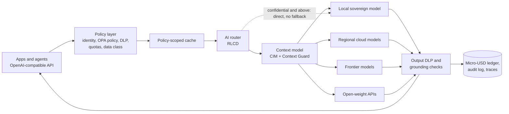

# AiVa: AI Value Assurance

**The sovereign AI control plane for the enterprise.**

*Govern every request. Optimize every token. Prove the value.*

AiVa is an open-source control plane that sits between an organisation's applications, agents and users on one side
and every AI model they use on the other: in-house models, regional cloud models and frontier APIs. Every request is
identified, checked against policy, scanned for sensitive data, classified, budgeted, routed to the most suitable
permitted model with only the context it needs, checked again on the way out, and recorded with its cost, savings and
evidence. It runs inside your own boundary, in your VPC, on-premises or in an in-country cloud.

This repository contains the AiVa **gateway** (the enforcement and optimisation engine) and the **Control Center**
(the management console), licensed under [Apache-2.0](LICENSE).

---

## Contents

- [Why AiVa](#why-aiva)
- [The value AiVa delivers](#the-value-aiva-delivers)
- [Who AiVa is for](#who-aiva-is-for)
- [Typical use cases](#typical-use-cases)
- [Key concepts](#key-concepts)
- [How a request flows](#how-a-request-flows)
- [Features](#features)
  - [Identity, access and ingress](#identity-access-and-ingress)
  - [Policy as code](#policy-as-code)
  - [Data protection: DLP, injection defence and classification](#data-protection-dlp-injection-defence-and-classification)
  - [Data sovereignty](#data-sovereignty)
  - [Model routing and model management](#model-routing-and-model-management)
  - [Context optimisation and governed retrieval](#context-optimisation-and-governed-retrieval)
  - [Response caching](#response-caching)
  - [Budgets, quotas and FinOps](#budgets-quotas-and-finops)
  - [Agents and tools](#agents-and-tools)
  - [Approvals](#approvals)
  - [Document generation](#document-generation)
  - [Output assurance and answer quality](#output-assurance-and-answer-quality)
  - [Insights: consumption, savings and value reporting](#insights-consumption-savings-and-value-reporting)
  - [Observability and audit](#observability-and-audit)
  - [APIs](#apis)
  - [Control Center](#control-center)
  - [Model providers and inference modes](#model-providers-and-inference-modes)
  - [Configuration as code](#configuration-as-code)
  - [Deployment and operations](#deployment-and-operations)
- [Benefits by stakeholder](#benefits-by-stakeholder)
- [Design guarantees](#design-guarantees)
- [The AI models AiVa uses](#the-ai-models-aiva-uses)
- [How AiVa compares](#how-aiva-compares)
- [Architecture](#architecture)
- [Getting started](#getting-started)
- [Adapting AiVa to your organisation](#adapting-aiva-to-your-organisation)
- [Sample configuration](#sample-configuration)
- [Status, limitations and roadmap](#status-limitations-and-roadmap)
- [Repository layout](#repository-layout)
- [Contributing, security and licence](#contributing-security-and-licence)

---

## Why AiVa

Enterprise AI adoption is moving faster than the controls around it. Three problems recur in every organisation that
uses generative AI at scale:

| Problem | What it looks like in practice |
|---|---|
| **Ungoverned** | Employees and applications send confidential data, personal data and secrets to public AI services. Prompts and documents cross borders. Each team wires models into its own application with its own rules, so nobody can say which model saw which data, or prove that a control was applied. |
| **Unaffordable** | Every request goes to the most capable and most expensive model, with the whole conversation or document attached. Identical questions are answered again and again. Token bills grow faster than usage, and budgets are discovered only after they are exceeded. |
| **Unproven** | Leaders cannot show what AI spending returned, per application, department, user or request. Savings are claimed but not measured, estimates are mixed with measurements, and regulators and auditors ask for evidence that nobody collected. |

Regulated organisations such as banks, telecom operators, government bodies, healthcare providers and energy companies
feel all three at once: data-protection and data-residency rules put many of the most capable public models out of
reach for much of their data, while the pressure to adopt AI keeps rising.

## The value AiVa delivers

AiVa turns AI from a set of unmanaged, per-team integrations into a governed, measurable enterprise service.

| Outcome | How AiVa delivers it |
|---|---|
| **Adopt AI safely, at scale** | One enforcement point for every AI call means policy, data protection and audit are built in once and apply to every application, instead of being re-implemented (or forgotten) in each one. |
| **Keep sensitive data where it belongs** | Data is classified on every request; confidential and higher classes are answered only by your own in-country model, by policy rather than by promise. |
| **Spend less for the same answers** | Each request goes to the least expensive model that can do the job, carries only the context the answer needs, and repeats are answered from cache. |
| **Never be surprised by a bill** | Budgets are reserved before money is spent, enforced at every level of the organisation, and reconciled afterwards, with alerts before limits are reached. |
| **Prove the value of every AI dollar** | Every request produces a receipt: route, tokens, cost, savings and checks, each figure labelled as measured or estimated, rolled up into reports by application, team, user and model. |
| **Stay independent of any one vendor** | One OpenAI-compatible API in front of every model. Swap, add or retire models in configuration without changing application code. |
| **Satisfy auditors and regulators** | Versioned, hashed policies; append-only usage ledger and audit log; per-request traces without prompt text; pseudonymous users with controlled identity resolution. |
| **Turn sovereign GPU capacity into a service** | Operators of in-country GPUs can expose their models through a governed, metered front door that enterprises can trust, charge back or buy. |

## Who AiVa is for

- **Enterprises in regulated industries** that must keep certain data in-country or on their own infrastructure while
  still using AI widely.
- **Platform and AI enablement teams** that want one paved road for every team building with AI.
- **Security, privacy and risk teams** that need enforceable controls and evidence, not guidelines.
- **Finance and FinOps teams** that need predictable AI spend, chargeback and proof of savings.
- **Telecom operators, sovereign cloud and GPU providers** that want to offer governed AI services on in-country
  infrastructure.
- **System integrators** that build AI solutions for regulated customers and need a reusable control layer.

## Typical use cases

AiVa is use-case agnostic: any application that calls an AI model can go through it. Common patterns:

- **Employee copilots and chat assistants** with policy-controlled access to models and data.
- **Customer support assistants** grounded in approved knowledge-base content.
- **Enterprise search and retrieval-augmented generation (RAG)** over approved, in-force documents with citations.
- **Coding assistants** that block credentials and keep sensitive identifiers off external models.
- **Investigations and case work** on confidential data, answered in-country only.
- **Operations and incident analysis** over large volumes of records, routed to the model the task needs.
- **Multi-step agents** that call tools under per-tool permissions and one budget.
- **Document generation** of editable reports and presentations from confidential inputs.
- **Research assistants** with governed access to external sources.

## Key concepts

| Concept | Meaning |
|---|---|
| **Tenant** | The organisation AiVa serves, with its departments, cost centres, applications, users, networks and budgets. |
| **Application** | A system that calls AiVa with its own credentials, grants (models, tools, data), classification floor and budget. |
| **Principal** | The caller of a request: an application key or a signed-in user with roles. |
| **Data class** | One of five sensitivity levels: public, internal, confidential, restricted, sovereign-only. |
| **Policy bundle** | The versioned, hashed set of policies OPA evaluates; every decision records the version and hash it used. |
| **Policy-eligible set** | The models a request may use after policy: routing chooses only inside it. |
| **Sovereign model** | A model you operate in-country; the only route for confidential and higher data. |
| **Context package** | The reduced, verified context sent to the answering model instead of the full conversation or document set. |
| **Reservation** | Budget held before a billable call for its maximum possible cost, then reconciled against actual usage. |
| **Run and attempt** | A run is one request through the pipeline; each model or tool call within it is an attempt with its own usage and cost. |
| **Ledger** | The append-only record of usage and cost in integer micro-USD; corrections are new rows. |
| **Provenance** | The label on every number: `measured`, `estimated`, `simulated`, `replayed` or `synthetic`. |
| **Receipt** | The per-request summary of route, tokens, cost, savings and checks returned to the caller and stored for reporting. |

## How a request flows



Every request passes through a 13-stage pipeline. Each stage emits a redacted trace span, including the stages it
skipped and why, so any request can be inspected afterwards as an execution graph.

| # | Stage | What it does |
|---|---|---|
| 1 | `ingress` | Authenticates the caller (application key or user token), resolves the application and checks the source network. |
| 2 | `policy` | Runs DLP and injection screening, sets the effective data class and asks OPA for a decision: allow, deny or require approval, with the policy-eligible models. A denied request stops here, before any model sees it. |
| 3 | `cache` | Answers a repeat from the policy-scoped exact or semantic cache, with no model call. |
| 4 | `rlcd1` | The AI router predicts task, sensitivity, complexity and context need; sensitivity can only tighten the data class. |
| 5 | `retrieval` | Retrieves approved, in-force, application-granted knowledge-base passages when the task needs them. |
| 6 | `cim` | The context model selects the evidence the answer needs and extracts required facts verbatim. Skipped when policy forbids it or the context is small. |
| 7 | `context_guard` | Independently verifies the context package (identifiers, facts, chronology, numbers, budget); on doubt, the full eligible context is used. |
| 8 | `rlcd2` | Chooses the final model inside the policy-eligible set, weighing cost and quality for the task. |
| 9 | `quota` | Reserves the maximum cost of the call against every applicable budget, atomically, before any spend. |
| 10 | `preflight` | Re-evaluates policy for the exact call about to be made (model, data class, egress). |
| 11 | `inference` | Calls the chosen model, with retries and safe handling of provider errors; the sovereign path never falls back. |
| 12 | `assurance` | Output DLP, grounding and citation checks before the answer is released. |
| 13 | `reconciliation` | Records actual usage and cost in the ledger, releases the unused reservation and writes the receipt. |

Policy is evaluated before optimisation and again before every context-model, upstream, baseline and tool call.

## Features

### Identity, access and ingress

- **Application keys** issued from the Control Center or CLI: the secret is shown once, stored only as a peppered hash,
  carries an expiry, records its last use, and can be revoked instantly.
- **User sign-in** with short-lived JWTs and role-based permissions. The built-in issuer uses HS256; verification is
  isolated so an OIDC/JWKS verifier can be plugged in.
- **Roles** for platform administrators, tenant administrators, finance analysts, department managers, security
  auditors, application owners and testers, each mapped to explicit permissions; the API and the Control Center both
  enforce them.
- **Trusted networks:** per-application CIDR rules, evaluated against the client address attested by a trusted proxy;
  the default is deny.
- **Fail closed:** if identity, policy, quota or idempotency services are unavailable, requests are refused rather
  than passed through.
- **Idempotency keys** on mutating calls, so client retries never execute or bill twice.
- **Optional demo modes,** off by default: a passcode sign-in for named demo users and a public visitor mode with
  recorded replays and capped live runs.

### Policy as code

- **Open Policy Agent (Rego v1)** decides every request, with policies stored as versioned documents in configuration.
- **Restrict-only composition:** policy documents can only narrow what is allowed, never widen a stricter rule.
- **Two-phase evaluation:** a request-stage decision before optimisation, and an egress decision before every
  downstream call (context model, upstream model, baseline, tool).
- **Decisions with reasons:** each decision returns rule identifiers, human-readable reasons and remediation hints,
  shown to callers and in the Control Center.
- **Lifecycle:** draft → validate → simulate against test requests → publish → roll back. A draft shows its changes
  from the published version, and rollback re-publishes an earlier hashed bundle.
- **Model switches:** turn a granted model off or on for one application as an audited policy change.
- **Dry-run API:** evaluate the request-stage decision for any input without calling a model.
- **Every decision is recorded** with the policy version and bundle hash it used.

### Data protection: DLP, injection defence and classification

- **DLP on input and output** using Microsoft Presidio with custom recognisers for subscriber, device and financial
  identifiers (MSISDN, IMSI, ICCID, IMEI, IBAN, payment cards, national identifiers), secrets, API keys and private
  keys, plus a tenant vocabulary so product and organisation names are not mistaken for people.
- **Policy actions on findings:** block, require approval, or tighten the data class, depending on the finding type
  and policy.
- **Prompt-injection detection** on the prompt and on retrieved and tool-returned text, including obfuscated attacks;
  retrieved evidence reaches the model only inside a wrapper that marks it as data.
- **Tighten-only classification:** the effective class is the strictest of the declared class, the application's
  floor, DLP findings and the AI router's sensitivity prediction. Nothing can lower it.
- **Output DLP** withholds secrets or sensitive identifiers that appear in a model's answer.

### Data sovereignty

- **Direct sovereign path:** confidential, restricted and sovereign-only requests go straight to an in-country model,
  skipping external context services entirely.
- **No fallback:** if the sovereign model is unavailable, the request fails safely; it is never retried on another model.
- **Retrieval on the sovereign path:** knowledge-base retrieval works for sovereign requests too, inside the boundary.
- **Region-aware models:** each model in the registry records its hosting region and whether it is sovereign or
  external; policy uses these facts, not names.
- **Evidence for regulators:** classification, residency enforcement, an inventory of AI systems and models, and
  per-request audit trails support data-protection, cloud-security and AI-governance obligations. AiVa supports
  compliance work; it does not certify compliance.

### Model routing and model management

- **AI router (RLCD):** a calibrated multi-head classifier reads each request and predicts task, sensitivity,
  complexity and context need. The router then chooses the lowest-cost model that qualifies for the task, counting
  the GPU time of in-house models, and only inside the policy-eligible set.
- **Confidence-aware:** each prediction is used only above its calibrated threshold; otherwise transparent rules decide.
- **Routing modes:** `hybrid` (the router decides), `local-only` (in-country models only) and `pinned` (a named
  model, if policy allows it). Caller hints such as tags or a preferred model are hints, never authorisation.
- **Quality tiers** (`standard`, `high`, `critical`) let applications ask for stronger models for critical work.
- **Your own sovereign model as a route:** an in-country model is a first-class option, the only route for sensitive
  classes and a low-cost route for everything else.
- **Model registry:** every model with its pinned revision, provider, region, sovereign and external flags, context
  window, rate card and hosting details, visible in the Control Center.
- **Model allowlist:** per-application grants; a request can only reach models its application is granted and policy
  allows.
- **Pinned, scale-to-zero endpoints:** a dedicated GPU endpoint must serve exactly the pinned weights and revision,
  or calls fail closed. A request wakes a scaled-down endpoint; while it starts, the context model falls back to the
  full context and the sovereign path returns a retryable error instead of falling back to another model.
- **Optional baseline comparison:** run the same request against a reference model for comparison; it is metered
  separately and never counted as savings.

### Context optimisation and governed retrieval

- **Context model (CIM):** a small fine-tuned model selects the passages and conversation turns an answer needs and
  copies required facts verbatim, as structured JSON.
- **The gateway builds the package** from exactly the kept passages, unchanged, so nothing is paraphrased away.
- **Context Guard:** an independent check of every package (identifiers, verbatim facts, chronology, numbers,
  citations and token budget). If anything cannot be verified, the full eligible context is sent instead, so AiVa can
  only remove tokens, never a required fact.
- **Context profiles** per use case declare which facts must always be preserved.
- **Governed retrieval (RAG):** hybrid BM25 and vector search (pgvector) with a reranker, over documents that are
  approved, in force on the request date, granted to the calling application and permitted for its data class.
  Expired, future-dated, confidential or other applications' documents are never retrieved.
- **Citations:** answers cite document and section identifiers that are checked against the retrieved passages.
- **Knowledge-base ingestion** from JSONL with metadata (identifiers, sections, validity dates, classification,
  application grants).
- **Governed web search** as a tool for research use cases, subject to tool policy and budget like any other tool.

### Response caching

- **Exact and semantic caching** of answers, so repeated and equivalent questions cost nothing upstream.
- **Policy-scoped:** cache entries are keyed by the policy bundle hash, knowledge-base version, application, data
  class and eligible models, so a policy change never serves an answer the new policy would not allow.
- **Privacy-aware sharing:** requests about the speaker ("my bill", "our contract") are cached only per end user and
  never semantically; customer-facing applications can cache every request per end user.
- **Measured effect:** cache hits are recorded with the upstream cost they avoided, labelled as an estimate.

### Budgets, quotas and FinOps

- **Hierarchical budgets** for the tenant, department, application, user, model, agent workflow and GPU pool, per
  period, with caps and alert thresholds.
- **Reserve before spend:** the maximum cost of output, retries, tools and context work is reserved atomically (Redis
  Lua scripts with a durable reservation journal) before any billable call, and reconciled afterwards.
- **Over-budget behaviour per scope:** block, require approval, or route to a cheaper model, never to a weaker policy.
- **Approved budget exceptions:** bounded, single-use cap lifts granted through the approval queue and audited.
- **Alerts** at configurable thresholds (80% and 95% by default), hard caps, overruns and reconciliation differences.
- **Anomaly detection:** rules flag token spikes per application, shifts towards expensive models, repeated retries,
  unusually high output ratios and unusual per-user consumption.
- **Money done right:** every amount is integer micro-USD; rate cards are versioned with their source and date; the
  GPU time of in-house models is costed alongside provider tokens.
- **Append-only ledger:** usage and cost per attempt; corrections are new rows, never edits.
- **Chargeback:** spend by application, department, cost centre, user and model, exportable for finance systems.

### Agents and tools

- **Governed multi-step workflows:** each step of an agent is a governed run with its own policy decision.
- **Tool registry:** each tool declares its access (read or write) and egress (internal or external).
- **Per-tool permissions:** every tool call is checked against the application's grants and policy before it runs.
- **One workflow budget** covers every step, so an agent cannot spend beyond its envelope.
- **Injection-safe:** instructions injected through tool output cannot trigger side effects.
- **No autonomous punitive actions:** actions with consequences for people require approval.
- **Pause and resume:** workflows waiting on approval resume from where they stopped once approved.

### Approvals

- **Approval queue** for decisions that require a human: policy outcomes marked approval-required and budget
  exceptions.
- **Re-evaluated on approval:** an approved request is checked again against the current policy version before it
  resumes.
- **Requester and approver views,** with every decision audited.

### Document generation

- **Editable DOCX and PPTX** drafted through a governed run; confidential inputs stay on the sovereign path.
- **Gateway-built files:** the model supplies content; the gateway builds the document, so the file structure is
  controlled.
- **Sandboxed previews:** documents are rendered for preview in a network-less, process-less sandbox, and only files
  AiVa generated are rendered.
- **Document checks** catch altered figures, invented numbers, missing or unknown citations and thin structure before
  a document is released.
- **Ownership:** documents are visible only to their owner and tenant; access attempts by others are refused and
  audited.

### Output assurance and answer quality

- **Output DLP** before release, as above.
- **Grounding and citation checks** for answers built on retrieved or supplied evidence.
- **Safe fallback** when a check fails: the answer is withheld or the request is re-run with full context, never
  silently degraded.
- **Optional answer-quality comparison:** a pinned frontier reference answers the same question on the full context,
  and a pinned grader model judges the served answer against it. Each call is policy-checked and budgeted, the
  result is recorded without text, and confidential data is never sent for comparison.
- **Quality reporting:** output assurance results, context sufficiency, Context Guard verdicts and comparison scores
  over time.

### Insights: consumption, savings and value reporting

- **Executive overview:** spend, tokens, requests, cache rate, quality pass rate and cost variance, with provenance.
- **Consumption reports** grouped by application, department, user, prompt category, model, data class and more,
  with global filters and time windows.
- **Classification reports:** the distribution of work by task, sensitivity, complexity and context need.
- **Optimisation reports:** context removed, cache effects, savings and the overhead of optimisation itself.
- **Savings waterfall:** cache, then context, then model choice, then provider caching, with nothing counted twice
  and the cost of the context model and GPU time included.
- **Governance reports:** denials, quota events, sovereign routing and exceptions by policy and rule.
- **Drill-down** from any figure to the matching runs, and from a run to its attempts, decisions and redacted trace.
- **Exports:** asynchronous CSV exports, permission-checked, time-limited and audited.
- **Privacy by default:** users appear as pseudonyms; resolving a pseudonym to an identity is a separate permission and
  every resolution is audited.
- **Scheduled aggregation** keeps reports current without querying raw runs.

### Observability and audit

- **Per-stage traces** for every request, including skipped stages with the reason, stored for the Trace Explorer;
  OpenTelemetry export (OTLP) is optional.
- **Redaction by design:** span attributes use an `aiva.*` namespace and pass a redaction filter; no prompt text, PII
  or secrets are stored in spans, run records or reporting tables.
- **Append-only audit log** of administrative actions, policy changes, approvals, key issuance and revocation,
  identity resolutions and exports.
- **Health probes:** liveness, and readiness that checks the database, Redis, OPA, the published policy bundle and the
  router model.
- **Provenance everywhere:** every number in APIs, reports and the console is labelled `measured`, `estimated`,
  `simulated`, `replayed` or `synthetic`. Estimates are never presented as measurements.

### APIs

| Area | Endpoints |
|---|---|
| **OpenAI-compatible** | `POST /v1/chat/completions`, `GET /v1/models`, `GET /v1/models/{id}`: use existing OpenAI SDKs and tools unchanged. `aiva-auto` lets AiVa route; a named model is served only if policy leaves it eligible, never substituted. Governance fields (data class, task, quality tier) travel in `X-AiVa-*` headers or metadata. Streaming requests are served after the full pipeline, including output checks. |
| **Native chat** | `POST /v1/ai/chat` returns the answer with its route, classification, policy decision, usage, cost, savings, provenance and optional trace. |
| **Policy** | `POST /v1/policy/evaluate` dry-runs a decision; admin endpoints list, draft, test, publish and roll back policy versions and switch models per application. |
| **Runs and traces** | Run detail with attempts and policy events, and the redacted execution trace. |
| **Approvals** | Request status for requesters; queue, approve and deny for approvers. |
| **Agents** | Start, list, inspect and resume governed agent workflows. |
| **Documents** | Draft, list, download and preview generated DOCX and PPTX files. |
| **Budgets** | Budgets with live status, alerts and on-demand reconciliation. |
| **Administration** | Applications and their keys, trusted networks, model allowlist, tool permissions and the model registry. |
| **Reports** | Overview, consumption, classification, optimisation, governance, quality, runs with drill-down, filters, exports and identity resolution. |
| **Catalog and session** | Sign-in options, the caller's profile and permissions, and the use-case catalog. |
| **Health** | Liveness and readiness probes. |

The full contract is generated from the code into [`contracts/openapi.json`](contracts/openapi.json), with JSON schemas
for the policy input and decision, the context-model interface and the event envelope. A typed TypeScript client is
generated from it.

### Control Center

A role-aware web console. Each person sees only the views their permissions allow.

- **Test Console:** a use-case library, a run workspace to send requests and inspect the decision, route, context,
  cache, tokens, cost and savings of each run, generated documents, and agent workflows.
- **Overview:** the executive dashboard.
- **Govern:** applications and identities (including application keys), trusted networks, policy rules and versions
  (draft, simulate, publish, roll back), model allowlist, tool permissions, budgets and quotas, and the approval queue.
- **Optimize:** the model registry with pinned revisions and hosting details.
- **Insights:** consumption overview, applications, users, prompt categories, models, savings, quotas and the export
  centre.
- **Quality and assurance:** output checks, context sufficiency, Guard verdicts and answer-quality comparisons.
- **Audit:** the Trace Explorer.
- **Settings.**

The console is accessible (tested against WCAG 2.2 AA), reflows down to small screens, and is built to support
right-to-left languages: all copy goes through translation keys and layouts use CSS logical properties.

### Model providers and inference modes

- **Provider adapters** for Anthropic, Google Gemini and any OpenAI-compatible endpoint, including the Hugging Face
  inference router and self-hosted vLLM servers for in-country models.
- **Inference modes:**
  - `simulated` (default): no provider calls, outputs labelled `simulated`, for development and evaluation;
  - `live`: real provider calls with keys from the environment;
  - `record` and `replay`: provider exchanges are recorded and replayed, so tests and demos run offline. Recordings
    strip credentials and private endpoint hostnames.
- **Per-run execution mode:** a deployment can serve a recorded replay or a live run per request, for demonstrations
  and safe testing.

### Configuration as code

Everything tenant-specific lives in versioned YAML under [`config/`](config/), validated on load (including every
cross-reference between applications, models, tools, policies and budgets): the tenant and its organisation, models
and rate cards, policies and DLP vocabulary, tools, context profiles, the classification taxonomy, Insights
thresholds and the use-case catalog. `aiva-admin seed` loads it into the database and publishes the policy bundle to
OPA, so configuration changes are reviewed and deployed like code.

### Deployment and operations

- **Two containers:** the gateway and the Control Center. The gateway image can bring its own PostgreSQL, Redis and
  OPA for a single-container start, or use external managed services.
- **Runs anywhere you run containers:** a VPC, an on-premises cluster or an in-country cloud.
  [`deploy/compose.yaml`](deploy/compose.yaml) starts the pair locally.
- **Environment-only secrets:** database, Redis, JWT secret, credential pepper, pseudonym key and provider keys are
  read from environment variables, never from files in the repository.
- **Migrations** with Alembic, checked in CI to match the models.
- **Background jobs** in the gateway: budget reconciliation, Insights aggregation and anomaly detection.
- **`aiva-admin` CLI:** migrate, seed, issue credentials, mint tokens, ingest knowledge bases, generate synthetic
  traffic for Insights, refresh aggregates and export contracts.

## Benefits by stakeholder

| Stakeholder | Benefits |
|---|---|
| **CISO and security** | One non-bypassable enforcement point; default deny; fail-closed behaviour; DLP and injection defence on prompts, retrieved text, tool output and answers; per-request evidence. |
| **Data protection officer** | Classification on every request; sensitive data kept in-country by policy; pseudonymous reporting; controlled, audited identity resolution. |
| **CFO and FinOps** | Predictable spend with reservations and caps at every level; chargeback; itemised savings; anomaly alerts; integer-precise costing including GPU time. |
| **CIO and platform teams** | One OpenAI-compatible endpoint for every model; model changes without code changes; consistent controls for every team; deployable inside your own boundary. |
| **Application teams** | Faster approval to use AI on real data; built-in retrieval, caching, routing and document generation; clear refusal reasons and remediation. |
| **Risk, compliance and audit** | Versioned, hashed policies; append-only audit and ledger; complete traces without prompt text; an inventory of AI systems and models. |
| **Business leaders** | Visibility of what AI is used for, by whom, at what cost and with what savings, with every figure's provenance stated. |
| **Operators of sovereign infrastructure** | A governed, metered front door to in-country models that customers can trust and be billed for. |

## Design guarantees

These rules are enforced in code, covered by automated tests in [`gateway/tests/invariants/`](gateway/tests/invariants/)
and in the policy tests, and are never weakened:

- Policy is evaluated before optimisation and again before every context-model, upstream, baseline and tool call.
- Confidential, restricted and sovereign-only payloads never reach a context service or an external provider. They
  take the sovereign direct path, and that path never falls back to another model. There are no exceptions.
- The router only chooses inside the policy-eligible set and cannot weaken policy or budgets.
- A budget reservation exists before any billable stage. An unavailable policy engine, quota store or idempotency
  store fails closed.
- The effective classification is the most restrictive of the declared class, the application floor, DLP and the
  router.
- No prompt text, PII or secrets in spans, run records or reporting tables.
- Every number carries provenance; simulated or estimated values are never presented as measured.
- Money is integer micro-USD. The usage ledger and audit log are append-only; corrections are new rows.

## The AI models AiVa uses

AiVa's hardest decisions are made by models trained for the job. You can use the published models, retrain them on
your own data, or replace them.

| Model | Role | Where to get it |
|---|---|---|
| **RLCD** (ModernBERT-base classifier) | The AI router: predicts task, sensitivity, complexity and context need for each request, on CPU. | [`s-ttp/aiva-rlcd-modernbert`](https://huggingface.co/s-ttp/aiva-rlcd-modernbert), with a training kit |
| **CIM** (Qwen3-4B fine-tune) | The context model: selects evidence and extracts required facts as verifiable JSON. | [`s-ttp/aiva-cim-qwen3-4b-v7`](https://huggingface.co/s-ttp/aiva-cim-qwen3-4b-v7), with a training kit |
| **Sovereign model** | Answers sensitive requests in-country and serves as a low-cost route for the rest. | Bring your own: any open-weight model you approve, served with an OpenAI-compatible server such as vLLM, ideally fine-tuned on your domain. |

The published models were trained and evaluated on synthetic data. Their model cards describe how; re-calibrate them
on your own traffic before relying on them in production. Without GPUs, the gateway runs with a rule-based router
(`AIVA_RLCD_BACKEND=heuristic`) and simulated inference, so the whole pipeline can be explored on a laptop.

## How AiVa compares

| | AiVa | AI marketplaces and gateways | Hyperscaler routing |
|---|---|---|---|
| Policy decides which models are eligible, per data class | Yes | Partial: filter or redact | Partial |
| Sensitive data locked in-country, no fallback | Yes | Rarely | Region-dependent |
| Your own sovereign model built in as a route | Yes | Proxy to a self-hosted endpoint at best | In their cloud |
| Learned cost-quality routing inside policy | Yes | Mostly rules or provider-side | Within one cloud |
| Context compression with independent verification | Yes | Rare, unverified | No |
| Budget reserved before every billable call | Yes | Mostly metered after the fact | Partial |
| Every figure labelled measured or estimated | Yes | Rarely | Rarely |
| Runs fully in your VPC or on-premises | Yes | Some | Partial: their cloud regions |

## Architecture

| Component | Technology | Role |
|---|---|---|
| **Gateway** ([`gateway/`](gateway/)) | Python 3.12, FastAPI, async SQLAlchemy 2, Pydantic v2 | The 13-stage pipeline, policy enforcement, routing, context optimisation, FinOps, telemetry and reporting APIs |
| **Policy engine** ([`policies/`](policies/)) | Open Policy Agent, Rego v1 (`data.aiva.decision`) | Restrict-only policy with its own test suite |
| **Data** | PostgreSQL with pgvector, Redis | Runs, ledger, audit log, retrieval index; quotas, reservations, caches and idempotency |
| **DLP** | Microsoft Presidio with custom recognisers | Input and output scanning |
| **Model adapters** | Anthropic, Google Gemini, OpenAI-compatible | Upstream calls in simulated, live, record and replay modes |
| **Observability** | OpenTelemetry spans (redacted), stored for the Trace Explorer; OTLP export optional | Traces with no prompt text |
| **Control Center** ([`web/`](web/)) | React, TypeScript, Tailwind CSS, pnpm workspace | Management console, shared UI library and generated API client |

## Getting started

Prerequisites: Python 3.12 with [uv](https://docs.astral.sh/uv/), Node.js 22 with pnpm. Docker is optional.

**With Docker:**

```bash
docker compose -f deploy/compose.yaml up --build
# Gateway http://localhost:8000/gateway/docs · Control Center http://localhost:8080
```

**From source:**

```bash
bash scripts/dev-services.sh          # Postgres + pgvector :5432, Redis :6379, OPA :8181
make setup                            # Python and web dependencies
make migrate seed                     # schema, config/ into Postgres, policy bundle into OPA
make dev                              # gateway on http://localhost:8000/docs (simulated inference)
make check                            # lint, mypy --strict, opa fmt/test, pytest, web typecheck/test/build
```

Try it:

```bash
uv run aiva-admin seed --with-dev-credentials   # prints one development key per application
uv run aiva-admin mint-token --user u-tester    # JWT for a sample user
uv run aiva-admin kb-ingest gateway/tests/fixtures/kb/gct_kb_seed.jsonl   # load a sample knowledge base
uv run aiva-admin traffic --runs 60             # sample traffic for Insights
```

Call it with any OpenAI SDK:

```python
from openai import OpenAI

client = OpenAI(base_url="http://localhost:8000/v1", api_key="<application key from the seed command>")
reply = client.chat.completions.create(
    model="aiva-auto",  # let AiVa route; or name a registry model, served only if policy allows it
    messages=[{"role": "user", "content": "Summarise our refund policy."}],
)
print(reply.choices[0].message.content)
```

Run the Control Center against a local gateway:

```bash
AIVA_DEV_SIGN_IN=true AIVA_CORS_ORIGINS='["http://localhost:5173"]' make dev
pnpm -C web dev:console               # Control Center on http://localhost:5173
```

**Real models.** `AIVA_INFERENCE_MODE=live` calls real providers, with keys read from the environment
(`AIVA_ANTHROPIC_API_KEY`, `GEMINI_API_KEY`, `HF_TOKEN`). Point the context model and your sovereign model at your own
OpenAI-compatible endpoints in [`config/models.yaml`](config/models.yaml).

**Secrets** are read only from environment variables (`AIVA_DATABASE_URL`, `AIVA_REDIS_URL`, `AIVA_JWT_SECRET`,
`AIVA_CREDENTIAL_PEPPER`, `AIVA_PSEUDONYM_KEY` and provider keys). Never commit them; `.env` files are git-ignored.

## Adapting AiVa to your organisation

| File | What to set |
|---|---|
| [`config/tenant.yaml`](config/tenant.yaml) | Your organisation, departments, cost centres, applications, users, trusted networks and budgets |
| [`config/models.yaml`](config/models.yaml) | The models you allow, with pinned revisions, regions and whether each is sovereign |
| [`config/rate_cards.yaml`](config/rate_cards.yaml) | Prices per model (input, output, cached input, GPU hour) with source and date |
| [`config/policies/`](config/policies/) | Your AI policies and DLP vocabulary |
| [`config/tools.yaml`](config/tools.yaml) | Tools your agents may call, with access and egress |
| [`config/context_profiles.yaml`](config/context_profiles.yaml) | Which facts the context model must preserve per use case |
| [`config/taxonomy.yaml`](config/taxonomy.yaml) | Your classification taxonomy for Insights |
| [`config/insights.yaml`](config/insights.yaml) | Anomaly-detection rules and thresholds |
| [`config/scenarios.yaml`](config/scenarios.yaml) | Your use-case catalog for the Test Console |

Then load your approved documents with `aiva-admin kb-ingest`, retrain the router and the context model on your own
wording with their training kits if needed, deploy your sovereign model, and run `make migrate seed`.

## Sample configuration

So that AiVa runs out of the box, [`config/`](config/) ships a **fictional sample tenant**, GulfConnect Telecom, with
synthetic departments, applications, users, policies, documents and use cases. It exists to illustrate configuration
and to drive the automated tests; nothing in the platform depends on it, and none of its data is real. Its scenarios
(customer support, coding assistance, confidential investigation, enterprise retrieval, operations analysis, agent
workflows, caching, security and document generation) are functional illustrations, not benchmarks: results from the
sample tenant say nothing about performance on your data.

## Status, limitations and roadmap

- **Early release of a working proof of concept,** with automated tests for the design guarantees and the full
  request pipeline. It has no security certifications or production references yet.
- **One tenant per deployment** in this release.
- **Built-in user sign-in** issues HS256 tokens; plug in your identity provider through an OIDC/JWKS verifier.
- **Planned console views:** routing-policy, context-profile and cache-policy editors, and benchmark runs (the
  evaluation API currently returns `501 Not Implemented`).
- **English first:** Arabic and other right-to-left languages are planned; the code is ready for them (translation
  keys, logical CSS, a recorded `language` dimension).
- **The published router and context models** were trained on synthetic data and need calibration on real traffic.

## Repository layout

| Path | What |
|---|---|
| [`gateway/`](gateway/) | FastAPI gateway: `pipeline/`, `govern/`, `optimize/`, `inference/`, `assurance/`, `finops/`, `reporting/`, `agents/`, `artifacts/`, `auth/`, `api/`, `telemetry/`, migrations and tests |
| [`policies/`](policies/) | OPA Rego v1 policy and tests |
| [`config/`](config/) | Versioned configuration: the sample tenant, models, rate cards, policies, tools, profiles, taxonomy and use cases |
| [`contracts/`](contracts/) | Generated OpenAPI and JSON schemas (never hand-edited; `make contracts`) |
| [`web/`](web/) | pnpm workspace: the Control Center, a shared UI library and the generated API client |
| [`deploy/`](deploy/) | Container images and the Compose file |
| [`data/synthetic/kb/`](data/synthetic/kb/) | The sample tenant's synthetic knowledge base |
| [`docs/`](docs/) | The low-level design, architecture decision records and the scenario guide |

## Contributing, security and licence

- **Contributing:** see [`CONTRIBUTING.md`](CONTRIBUTING.md) for setup, checks and conventions.
- **Security:** please report vulnerabilities privately as described in [`SECURITY.md`](SECURITY.md).
- **Licence:** [Apache License 2.0](LICENSE). See [`NOTICE`](NOTICE).
