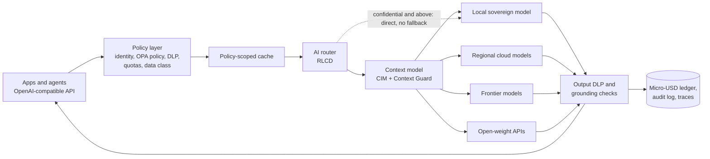

# AiVa: AI Value Assurance

**The sovereign AI control plane for the enterprise.**

*Govern every request. Optimize every token. Prove the value.*

AiVa sits between every enterprise application, agent and AI model, inside your own boundary. Every request is
checked against your policy before any model sees it, sent to the cheapest model that can do the job with only the
context it needs, and accounted for down to the micro-dollar, with evidence an auditor can follow.

This repository holds the AiVa **gateway** and its **Control Center** (the management console), licensed under
[Apache-2.0](LICENSE).

> **Status:** early open-source release of a working proof of concept. All bundled data is synthetic. The sample
> tenant, GulfConnect Telecom (GCT), is a fictional telecom operator used as the
> [reference demo](#reference-demo-gulfconnect-telecom-gct); everything tenant-specific lives in
> [`config/`](config/) and can be replaced with your own organisation. "AiVa" is a working name.

---

## Contents

- [Why AiVa](#why-aiva)
- [What AiVa does](#what-aiva-does)
- [How a request flows](#how-a-request-flows)
- [Capabilities](#capabilities)
- [The AI models AiVa uses](#the-ai-models-aiva-uses)
- [Benefits](#benefits)
- [How AiVa compares](#how-aiva-compares)
- [Architecture](#architecture)
- [Getting started](#getting-started)
- [Adapting AiVa to your organisation](#adapting-aiva-to-your-organisation)
- [Reference demo: GulfConnect Telecom (GCT)](#reference-demo-gulfconnect-telecom-gct)
- [Design guarantees](#design-guarantees)
- [Repository layout](#repository-layout)
- [Contributing, security and licence](#contributing-security-and-licence)
- [Status and limitations](#status-and-limitations)

---

## Why AiVa

Enterprise AI is arriving faster than it can be governed, afforded or proven:

| Problem | What it looks like |
|---|---|
| **Ungoverned** | Employees paste confidential data into public AI tools; prompts and documents leave the country; nobody can say which model saw what. |
| **Unaffordable** | Token bills grow faster than usage; every request goes to the most expensive model with the whole document attached; budgets are discovered after they are blown. |
| **Unproven** | Leaders cannot show what AI spend returned, per application, team or request, or prove to a regulator that controls were applied. |

Regulated organisations (banks, telecom operators, government and energy) feel all three at once, because
data-protection and data-residency rules make the cheapest, most capable public models off-limits for much of
their data.

## What AiVa does

AiVa is one control plane with three pillars, each answering one of the problems above.

| Pillar | Answers | In one line |
|---|---|---|
| **Govern** | Ungoverned | Policy as code, DLP and data classification on every request; sensitive data is answered only by your own in-country model. |
| **Optimize** | Unaffordable | An AI router picks the cheapest model that qualifies; a context model sends only the evidence the answer needs; budgets are reserved before any spend. |
| **Prove** | Unproven | Every request leaves a receipt: route, tokens, cost, savings and checks, each number labelled with its provenance. |

Applications connect through **one OpenAI-compatible API**, so existing SDKs and tools work unchanged. AiVa runs in
your VPC, on-premises or in an in-country cloud, and can route to:

- **your own local sovereign model** (an open-weight model fine-tuned on your domain, on in-country GPUs);
- **regional cloud models** hosted in-region;
- **frontier models** for the hardest tasks;
- **open-weight model APIs** for low-cost work.

## How a request flows



1. **Policy layer:** the caller is authenticated, OPA policy is evaluated, DLP and prompt-injection screening run, quotas
   are checked and the effective data class is set. A blocked prompt stops here, before any model sees it.
2. **Cache:** a policy-scoped exact and semantic cache answers repeats without calling a model.
3. **AI router (RLCD):** a purpose-built classifier reads task, complexity, sensitivity and context need, and picks
   the cheapest model that qualifies, only inside the set policy allows.
4. **Context model (CIM):** for long contexts, it selects only the evidence the answer needs. The Context Guard
   independently verifies every required fact before anything leaves; on doubt, the full context is used.
5. **Direct sovereign path:** confidential, restricted and sovereign-only requests skip external context services
   and go straight to the local sovereign model. That path never falls back to another model.
6. **Return path:** output DLP and grounding checks run before release. Tokens, GPU time, cost and savings are
   written to the append-only ledger, and the caller receives the answer with a request receipt.

Under the hood this is a 13-stage pipeline (`ingress → policy → cache → rlcd1 → retrieval → cim → context_guard →
rlcd2 → quota → preflight → inference → assurance → reconciliation`). Every stage emits a redacted span, including
the stages it skipped and why. Policy is re-evaluated before optimisation and again before every context-model,
upstream, baseline and tool call.

## Capabilities

### Govern: AI security, privacy and sovereignty

| Capability | What it does |
|---|---|
| **AI Policy Enforcement Layer** | OPA (Rego v1) policies are restrict-only, evaluated in two phases and re-checked before every downstream call. If the policy engine, quota store or idempotency store is unavailable, AiVa fails closed. |
| **Policy lifecycle** | Draft → validate → simulate against test requests → publish → roll back. Published bundles are hashed, and every decision records the policy version and hash. |
| **Identity and ingress** | Application keys are shown once, stored hashed, expire and can be revoked. Users sign in with short-lived JWTs (OIDC-ready). Trusted networks (CIDR) are checked behind a trusted proxy, and the default is deny. |
| **DLP and injection defence** | Presidio with custom recognisers for subscriber and financial identifiers (MSISDN, IMSI, ICCID, IMEI, IBAN, payment cards, national IDs), secrets and private keys. Prompt-injection detection covers the prompt and retrieved or tool-returned text. Output DLP runs before release. |
| **Tighten-only classification** | Five classes: public, internal, confidential, restricted, sovereign-only. The effective class is the strictest of the declared class, the application's floor, DLP and the AI router's sensitivity prediction. |
| **Data sovereignty** | Confidential data and above takes the direct sovereign path. It never reaches an external provider or context service and never falls back. Knowledge-base retrieval works on that path too. |
| **Model allowlist and switches** | Per-application model grants. An admin can switch a model off or on for one application as a policy change. |
| **Agents and tools** | Multi-step agent workflows run as governed steps. Every tool call is checked against a per-tool ACL (read/write access, internal/external egress) under one workflow budget. |
| **Approval queue** | Approval-required decisions and budget exceptions wait for a human. Approved requests are re-evaluated against the current policy version before they resume. |
| **Audit without exposure** | The audit log and usage ledger are append-only. No prompt text, PII or secrets are stored in spans, run records or reporting tables. Users are pseudonymous by default. |

### Optimize: token and cost optimisation

| Capability | What it does |
|---|---|
| **AI router (RLCD)** | A calibrated ModernBERT classifier with four heads (task, sensitivity, complexity, context need) picks the lowest-cost qualified model, counting the GPU time of in-house models. It falls back to rules when confidence is low. |
| **Local sovereign model as a route** | Your own fine-tuned in-country model is a first-class routing option: the only route for sensitive classes and a low-cost option for everything else. |
| **Context model (CIM) and Context Guard** | The CIM selects evidence and copies required facts verbatim; the gateway builds the package from exactly the kept passages. The Context Guard checks ids, facts, chronology, numbers and budget, and falls back to full context on doubt. |
| **Governed retrieval** | BM25 + pgvector + reranker over approved, in-force, application-granted documents only, with citations checked against their sources. Governed live web search is available for research use cases. |
| **Policy-scoped cache** | Exact and semantic caching, namespaced by policy version, region and user scope. A new policy version misses; a rollback re-pins its hash. |
| **Budget before spend** | Hierarchical quotas cover enterprise, department, application, user or key, model, agent workflow and GPU pool. The maximum cost of a call is reserved atomically (Redis Lua) before it is made, with idempotency keys so retries never double-charge, and reconciled afterwards. |
| **Bill-shock protection** | Alerts at configurable thresholds (80% and 95% by default) and hard caps. Over budget, a request is blocked, sent for approval or routed cheaper, never to a weaker policy. Budget exceptions are bounded, single-use and approved. |
| **Money done right** | All money is integer micro-USD. Rate cards are versioned with source and date. |

### Prove: value assurance and Insights

| Capability | What it does |
|---|---|
| **Request receipts** | Route and model chosen, tokens sent and received, context removed, cache effect and estimated saving against the default model, per request. |
| **Provenance on every number** | Each figure is labelled `measured`, `estimated`, `simulated`, `replayed` or `synthetic`. Estimates are never presented as measurements. |
| **Consumption intelligence** | Spend and tokens by application, department, user, prompt category and model; workload by classification; optimisation, governance and quality reports; drill-down from a KPI to a single redacted run. |
| **Savings, itemised** | A savings waterfall: cache, then context, then model choice, then provider caching. Nothing is counted twice, and the context-model and GPU costs are included. |
| **Output assurance** | Output DLP, grounding and citation checks, document-output checks, and an optional answer-quality comparison against a frontier reference, for data that may leave (never for confidential data). |
| **Trace Explorer** | Redacted execution traces with every pipeline stage, its decision and its reason. |
| **Exports and identity resolution** | Asynchronous CSV exports that are RBAC-enforced, time-limited and audited. Resolving pseudonyms to identities is separately permissioned and audited. |

### Built for developers and operators

| Capability | What it does |
|---|---|
| **OpenAI-compatible API** | `POST /v1/chat/completions` and `GET /v1/models` through the full AiVa pipeline: point an existing SDK at AiVa and keep your code. |
| **Native API** | `POST /v1/ai/chat` returns the answer with full governance metadata. `POST /v1/policy/evaluate` dry-runs a policy decision without calling a model. |
| **Document copilot** | Drafts editable DOCX and PPTX on the sovereign path. The gateway builds the file, previews render in a network-less sandbox, and checks catch altered figures, invented numbers and missing citations. |
| **Control Center** | A web console for the run workspace and Trace Explorer; Govern (applications and keys, model allowlist, tool permissions, trusted networks, policy versions, approval queue); budgets, quotas and alerts; Insights reports; agent workflows; artifacts; and quality. Role-aware, and Arabic-ready through i18n keys and logical CSS. |
| **Inference modes** | `simulated` (default, no provider calls), `live` (real providers), and `record`/`replay` of provider exchanges for CI and offline evaluation. |
| **Contracts first** | Generated OpenAPI and JSON schemas in [`contracts/`](contracts/) and a typed web client. |

## The AI models AiVa uses

AiVa is AI-native: its hardest decisions are made by models trained for the job, not by static rules. Figures below
were measured on **held-out synthetic test sets**; expect lower accuracy on real traffic until the models are
re-calibrated on it.

| Model | Role | Measured (synthetic, held-out) | Weights |
|---|---|---|---|
| **RLCD** (ModernBERT-base, 149M) | Router: task, sensitivity, complexity, context need | Sensitivity accuracy 0.983. Confidential-or-higher requests classified too low: 1.4% alone, 0.5% with DLP alongside. CPU p50 about 146 ms. | [`s-ttp/aiva-rlcd-modernbert`](https://huggingface.co/s-ttp/aiva-rlcd-modernbert), with a training kit |
| **CIM** (Qwen3-4B fine-tune) | Context model: selects evidence, extracts facts as verifiable JSON | 98.8% of replies pass the Context Guard; fact recall 0.981 and precision 0.989; 29.4% less context on average; no planted injection ever kept. | [`s-ttp/aiva-cim-qwen3-4b-v7`](https://huggingface.co/s-ttp/aiva-cim-qwen3-4b-v7), with a training kit |
| **Local sovereign model** | Answers sensitive requests in-country; a low-cost route for the rest | Bring your own: any open-weight model you approve, served with an OpenAI-compatible server such as vLLM. The reference deployment used a Qwen3-32B LoRA fine-tune. | Yours |

Without GPUs, the gateway runs with a heuristic router (`AIVA_RLCD_BACKEND=heuristic`) and simulated inference, so you
can explore the whole pipeline on a laptop.

## Benefits

| For | Benefit |
|---|---|
| **CISO and data protection** | One enforcement point for every AI call. Sensitive data stays in-country by policy, not by promise. DLP and injection defence apply to prompts, retrieved text, tool output and answers. |
| **CFO and FinOps** | Spend is reserved before it happens, capped at every level and itemised to the request. Savings from caching, smaller contexts and cheaper models are measured separately. |
| **CIO and platform teams** | One OpenAI-compatible endpoint for every model. Models can be swapped without code changes, and the platform deploys inside your own boundary. |
| **Application and data teams** | Faster approval to use AI on real data, because the controls are built in. Answers grounded only in approved documents, with citations. |
| **Risk, audit and regulators** | Policy versions with hashes, append-only audit and ledger, an AI system inventory and per-request evidence. Every number states whether it was measured or estimated. |
| **Operators of sovereign GPU capacity** | A governed, metered front door to in-country models that enterprises can trust, charge back or buy. |

AiVa supplies classification, residency enforcement, inventories and audit trails that support compliance work. It does
not certify compliance.

## How AiVa compares

| | AiVa | AI marketplaces and gateways | Hyperscaler routing |
|---|---|---|---|
| Policy decides which models are eligible, per data class | Yes | Partial: filter or redact | Partial |
| Sensitive data locked in-country, no fallback | Yes | Rarely | Region-dependent |
| Your own sovereign model built in as a route | Yes | Proxy to a self-hosted endpoint at best | In their cloud |
| Learned cost-quality routing inside policy | Yes | Mostly rules or provider-side | Yes, within one cloud |
| Context compression with independent verification | Yes | Rare, unverified | No |
| Budget reserved before every billable call | Yes | Mostly metered after the fact | Partial |
| Runs fully in your VPC or on-premises | Yes | Some | Partial: their cloud regions |

## Architecture

| Component | Technology | Role |
|---|---|---|
| **Gateway** ([`gateway/`](gateway/)) | Python 3.12, FastAPI, async SQLAlchemy 2, Pydantic v2 | The 13-stage pipeline, policy enforcement, router, context-model client, FinOps, telemetry and reporting APIs |
| **Policy engine** ([`policies/`](policies/)) | Open Policy Agent, Rego v1 (`data.aiva.decision`) | Restrict-only policy with tests |
| **Data** | PostgreSQL with pgvector, Redis | Runs, ledger, audit log, retrieval index, quotas and reservations, caches |
| **DLP** | Microsoft Presidio with custom recognisers | Input and output scanning |
| **Model adapters** | Anthropic, Google Gemini and OpenAI-compatible (Hugging Face router, vLLM endpoints) | Upstream calls in simulated, live, record and replay modes |
| **Observability** | OpenTelemetry spans (redacted, `aiva.*` attributes), stored for the Trace Explorer; OTLP export optional | Traces with no prompt text |
| **Control Center** ([`web/`](web/)) | React, TypeScript, Tailwind, pnpm workspace | Management console, shared UI and typed API client |

Both run as containers ([`deploy/`](deploy/)); the gateway image brings its own Postgres, Redis and OPA for a
single-container start. [`deploy/compose.yaml`](deploy/compose.yaml) runs the pair locally, and the same images run in
any VPC, on-premises cluster or in-country cloud.

## Getting started

Prerequisites: Python 3.12 with [uv](https://docs.astral.sh/uv/), Node.js 22 with pnpm. Docker is optional.

**With Docker:**

```bash
docker compose -f deploy/compose.yaml up --build
# Gateway http://localhost:8000/gateway/docs · Control Center http://localhost:8080
```

**From source:**

```bash
bash scripts/dev-services.sh          # Postgres + pgvector :5432, Redis :6379, OPA :8181
make setup                            # Python and web dependencies
make migrate seed                     # schema, config/ into Postgres, policy bundle into OPA
make dev                              # gateway on http://localhost:8000/docs (simulated inference)
make check                            # lint, mypy --strict, opa fmt/test, pytest, web typecheck/test/build
```

Try it:

```bash
uv run aiva-admin seed --with-dev-credentials   # prints one development key per application
uv run aiva-admin mint-token --user u-tester    # JWT for a seeded demo user
uv run aiva-admin kb-ingest gateway/tests/fixtures/kb/gct_kb_seed.jsonl   # load a synthetic knowledge base
uv run aiva-admin traffic --runs 60             # synthetic traffic for Insights
```

Run the Control Center against a local gateway:

```bash
AIVA_DEV_SIGN_IN=true AIVA_CORS_ORIGINS='["http://localhost:5173"]' make dev
pnpm -C web dev:console               # Control Center on http://localhost:5173
```

**Real models.** `AIVA_INFERENCE_MODE=live` calls real providers, with keys read from the environment
(`AIVA_ANTHROPIC_API_KEY`, `GEMINI_API_KEY`, `HF_TOKEN`). Point the context model and your sovereign model at your own
OpenAI-compatible endpoints in [`config/models.yaml`](config/models.yaml).

**Secrets** are only ever read from environment variables (`AIVA_DATABASE_URL`, `AIVA_REDIS_URL`, `AIVA_JWT_SECRET`,
`AIVA_CREDENTIAL_PEPPER`, `AIVA_PSEUDONYM_KEY` and the provider keys above). Never commit them; `.env` files are
git-ignored.

## Adapting AiVa to your organisation

Everything tenant-specific is versioned configuration, validated on load. To model your own organisation, replace the
sample tenant's files:

| File | What to set |
|---|---|
| [`config/tenant.yaml`](config/tenant.yaml) | Your organisation, departments, cost centres, applications, users, trusted networks and budgets |
| [`config/models.yaml`](config/models.yaml) | The models you allow, with pinned revisions, regions and whether each is sovereign |
| [`config/rate_cards.yaml`](config/rate_cards.yaml) | Prices per model (input, output, cached, GPU hour) with source and date |
| [`config/policies/`](config/policies/) | Your AI policies and DLP vocabulary |
| [`config/tools.yaml`](config/tools.yaml) | Tools your agents may call, with access and egress |
| [`config/taxonomy.yaml`](config/taxonomy.yaml) | Your classification taxonomy for Insights |
| [`config/context_profiles.yaml`](config/context_profiles.yaml) | Which facts the context model must preserve per use case |

Then retrain the router and the context model on your own wording with their training kits, fine-tune your sovereign
model on your domain, and run `make migrate seed` to load the result.

## Reference demo: GulfConnect Telecom (GCT)

To show AiVa end to end, the repository ships a **fictional sample tenant**: GulfConnect Telecom, a Gulf telecom operator
with synthetic subscribers, documents, alarms and policies. None of its data is real, and nothing in the platform
depends on it. Ten synthetic scenarios exercise the platform, each backed by an integration test
([`docs/scenarios.md`](docs/scenarios.md)):

| # | Scenario | What it proves |
|---|---|---|
| 1 | Customer support chatbot | Knowledge-base answers, context pruning of a long chat, cheap-model routing and full cache hits on repeats |
| 2 | Coding assistant | Generated code passes its tests; prompts with credentials are blocked; subscriber identifiers stay on the sovereign model |
| 3 | Fraud investigation | Confidential work goes sovereign-direct with zero external calls; every timestamp survives; a punitive action is denied |
| 4 | Enterprise RAG | Only approved, in-force, granted documents are retrieved and cited |
| 5 | Network operations | Sixty alarms route to a frontier model; a tampered timestamp is caught by the Context Guard |
| 6 | Agentic workflow | Per-tool policy on every step, one workflow budget, approval and resume, injected tool output blocked |
| 7 | Arabic–English support | Deferred in this English-only phase |
| 8 | Repeated queries and caching | Exact and semantic hits with no model call; caches respect region, user and policy version |
| 9 | Security and exfiltration | Injection and credentials blocked before any model call; leaked secrets in output withheld |
| 10 | Confidential document copilot | A board pack drafted sovereign-direct into editable PPTX and DOCX, every figure and citation checked |

```bash
uv run pytest gateway/tests/scenarios -v   # every scenario on recorded provider exchanges, no provider calls
```

An optional **public demo mode** lets anonymous visitors explore a deployment with recorded replays and a capped daily
budget for live runs. It is off unless the tenant config defines a public visitor and the gateway runs behind an
attested proxy; see [ADR-0019](docs/adr/0019-public-demo-replay-and-capped-live-runs.md).

## Design guarantees

These rules have automated tests in [`gateway/tests/invariants/`](gateway/tests/invariants/) and are never weakened:

- Policy is evaluated before optimisation and again before every context-model, upstream, baseline and tool call.
- Confidential, restricted and sovereign-only payloads never reach a context service or an external provider. They
  take the sovereign direct path, and that path never falls back to another model. There are no exceptions.
- The router only chooses inside the policy-eligible set and cannot weaken policy or budgets.
- A budget reservation exists before any billable stage. An unavailable policy engine, quota store or idempotency
  store fails closed.
- The effective classification is the most restrictive of declared, application floor, DLP and router.
- No prompt text, PII or secrets in spans, run records or reporting tables.
- Every number carries provenance; simulated or estimated values are never presented as measured.
- Money is integer micro-USD. The usage ledger and audit log are append-only; corrections are new rows.

## Repository layout

| Path | What |
|---|---|
| [`gateway/`](gateway/) | FastAPI gateway: `pipeline/`, `govern/`, `optimize/`, `inference/`, `assurance/`, `finops/`, `reporting/`, `auth/`, `api/`, `telemetry/`, migrations and tests |
| [`policies/`](policies/) | OPA Rego v1 policy and tests |
| [`config/`](config/) | Versioned sample tenant: applications, models, tools, rate cards, policies, scenarios and taxonomy |
| [`contracts/`](contracts/) | Generated OpenAPI and JSON schemas (never hand-edited; `make contracts`) |
| [`web/`](web/) | pnpm workspace: Control Center, shared UI and typed API client |
| [`deploy/`](deploy/) | Container images and the Compose file |
| [`data/synthetic/kb/`](data/synthetic/kb/) | The sample tenant's synthetic knowledge base |
| [`docs/`](docs/) | The low-level design, decision records and the scenario guide |

## Contributing, security and licence

- **Contributing:** see [`CONTRIBUTING.md`](CONTRIBUTING.md) for setup, checks and conventions.
- **Security:** please report vulnerabilities privately as described in [`SECURITY.md`](SECURITY.md).
- **Licence:** [Apache License 2.0](LICENSE). See [`NOTICE`](NOTICE).

## Status and limitations

- **Proof of concept.** Built to the design in [`docs/lld/`](docs/lld/) and its [decision records](docs/adr/), with
  automated tests for the design guarantees. It has no security certifications or production references yet.
- **Synthetic data only.** Model figures come from synthetic held-out tests and will be lower on real traffic until the
  models are re-calibrated.
- **English first.** Arabic language support and a right-to-left interface are planned; the code is Arabic-ready
  (i18n keys, CSS logical properties, a recorded `language` dimension).
- **Single tenant per deployment** in this release.
